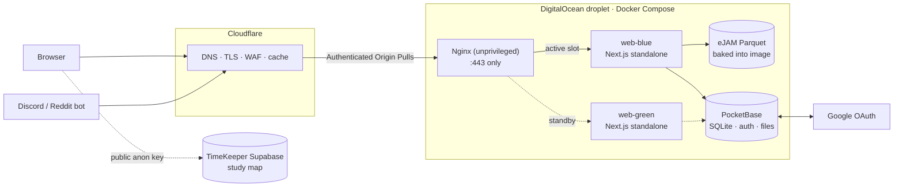
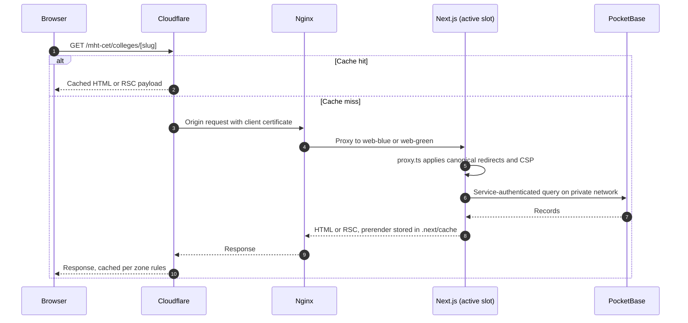
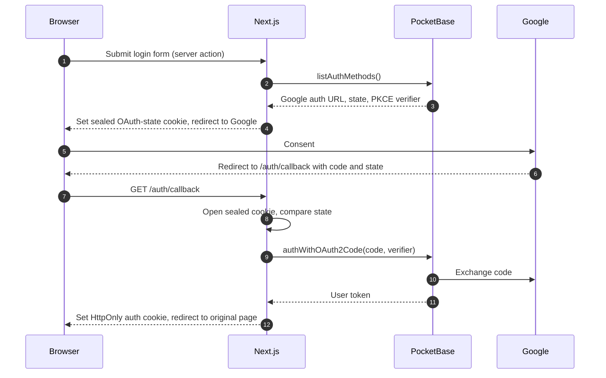
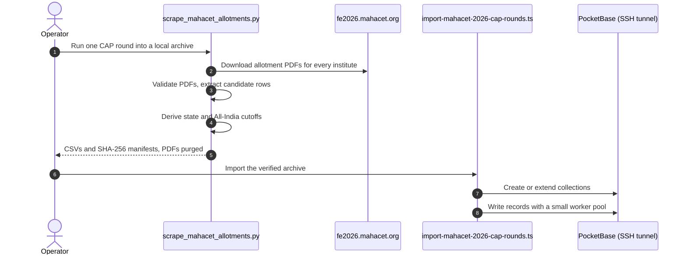
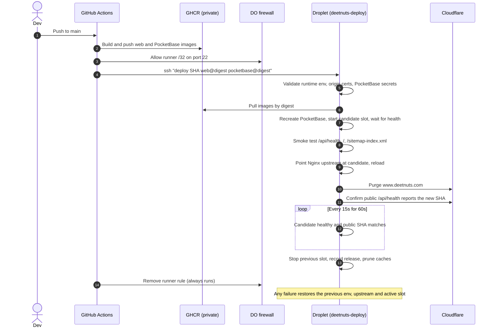

# DEETNUTS

Admissions data for Indian engineering entrance exams: MHT-CET cutoffs and college data, JEE Main and JEE Advanced cutoffs, a college predictor, and exam countdowns.

Live at **[www.deetnuts.com](https://www.deetnuts.com)**.

## Contents

- [What it serves](#what-it-serves)
- [Architecture](#architecture)
- [Request flows](#request-flows)
- [Data ingestion](#data-ingestion)
- [Deployment](#deployment)
- [Repository layout](#repository-layout)
- [Local development](#local-development)
- [Documentation](#documentation)
- [License](#license)

## What it serves

| Area                      | Routes                                                                          | Data                                                                                          |
| ------------------------- | ------------------------------------------------------------------------------- | --------------------------------------------------------------------------------------------- |
| MHT-CET state cutoffs     | `/mht-cet/state-cutoffs`, `/mht-cet/all-state-cutoffs/[year]/[round]`           | PocketBase. 2024 rounds 1-3, 2025 rounds 1-4, 2026 rounds 1-4                                 |
| MHT-CET All-India cutoffs | `/mht-cet/all-india-cutoffs`                                                    | PocketBase. 2024 rounds 1-3 via API (UI shows round 1). 2026 rounds 1-4 loaded, not yet in UI |
| MHT-CET colleges          | `/mht-cet/colleges`, `/mht-cet/colleges/[slug]`                                 | PocketBase. 2024 college master and seat matrix                                               |
| JEE cutoffs               | `/jee-main/colleges/...`, `/jee-advanced/colleges/...`, `/josaa/institutes/...` | eJAM Parquet release (JoSAA, CSAB), bundled in the image                                      |
| College predictor         | `/college-predictor`, `/api/predict/[exam_id]`                                  | eJAM predictors for JEE Main, JEE Advanced, MHT-CET                                           |
| Exam countdown            | `/exam-countdown`                                                               | Checked-in exam metadata. Study map uses TimeKeeper's Supabase project                        |
| Accounts                  | `/login`, `/account`, `/profile`                                                | PocketBase auth with Google OAuth                                                             |
| Cutoff bot                | `/api/bot/*`                                                                    | Discord interactions and a Reddit worker (`bot/`)                                             |

## Architecture



| Layer     | Choice                                                                        |
| --------- | ----------------------------------------------------------------------------- |
| Framework | Next.js 16.3 (App Router, standalone output, React Compiler)                  |
| UI        | React 19.2, Tailwind CSS 3.4, TypeScript 5.9                                  |
| Data/auth | PocketBase 0.40 (SQLite), JS SDK 0.28                                         |
| JEE data  | eJAM workspace (`ejam/`), Parquet verified against a pinned SHA-256 manifest |
| Edge      | Cloudflare, managed with Terraform in `infra/cloudflare`                      |
| Origin    | One DigitalOcean droplet (1 GiB), Nginx, blue/green web slots                 |
| CI/CD     | GitHub Actions, private GHCR images addressed by digest                       |

Boundaries:

- **Only Nginx publishes a port.** The cloud firewall admits 443 from Cloudflare ranges only, and Nginx rejects requests without Cloudflare's client certificate.
- **PocketBase is private.** It listens on the Compose network and on host loopback `127.0.0.1:8090` for administration over an SSH tunnel. Browsers never reach it.
- **Server-side data access.** `lib/pocketbaseClient.ts` authenticates as a service account with the `app_services` role. User-scoped writes use the signed-in user's token and collection rules.
- **Hardened containers.** Read-only root filesystems, `cap_drop: ALL`, `no-new-privileges`, and fixed memory limits.
- **Single VM.** Blue/green removes release downtime, not host failure. PocketBase is backed up daily with verified archives.

## Request flows

### Public page



### Google sign-in



`proxy.ts` redirects `/account` and `/profile` to `/login` when the auth cookie is absent. Server code refreshes the token against PocketBase on each authenticated request.

## Data ingestion

MHT-CET 2026 cutoffs are derived from the official per-institute CAP allotment PDFs. Earlier datasets came from the original Supabase project through the one-time migration in `scripts/migrate-supabase-to-pocketbase.ts`.



The production batch API is disabled, so the importer writes record by record. Every data collection carries the `source_reserved_*` fields defined in `lib/pocketbase/source-record.ts`.

## Deployment

A push to `main` runs [`production.yaml`](./.github/workflows/production.yaml). The deploy job runs only when the repository variable `DO_DEPLOY_ENABLED` is `true`.



- The deploy key is bound to a forced command that accepts only `deploy`, `rollback SHA`, and `status`.
- The last three releases are kept for rollback. The stopped slot keeps its image, so rolling back one release needs no pull.
- `npm run deploy:production` re-runs the workflow on `main`. Confirm completion on the **Deploy** job, not the build.
- Host timers: daily PocketBase backup at 04:15 UTC (ZIP, SHA-256, per-table row counts, three copies kept) and an hourly cache prune when the web cache volumes exceed 6 GiB.

Host layout, secrets, bootstrap, and Cloudflare setup: [`deploy/README.md`](./deploy/README.md).

## Repository layout

```text
app/                 App Router pages, layouts, and route handlers (app/api)
components/          UI components
lib/                 Data access, auth, SEO metadata, bot logic
proxy.ts             Canonical redirects, auth gate, exam-countdown CSP
ejam/                Vendored eJAM workspace: predictors, data CLI, Parquet data
pocketbase/          PocketBase image, hooks, and migrations
scripts/             Scrapers, importers, generators, verification
bot/                 Reddit worker
deploy/              Host scripts, Nginx, systemd units, env templates
infra/cloudflare/    Terraform for the Cloudflare zone
timekeeper-compat/   Cloudflare Worker for the legacy TimeKeeper domain
e2e/                 Playwright tests
data/                Checked-in source data
docs/                Architecture notes
supabase/, legacy/   Historical schema and removed code, kept for provenance
```

## Local development

Requirements: Node.js 22+, npm, and a reachable PocketBase instance with an `app_services` service account. Python 3 is needed only for the scrapers.

```bash
git clone https://github.com/kewonit/deetnuts && cd deetnuts
npm ci
npm exec --yes --package=pnpm@11.1.3 -- pnpm --dir ejam install --frozen-lockfile
cp .env.example .env.local
npm run dev    # http://localhost:3000
```

Runtime variables, validated in `env.ts`:

| Variable                                                  | Required | Purpose                                                             |
| --------------------------------------------------------- | -------- | ------------------------------------------------------------------- |
| `NEXT_PUBLIC_APP_URL`                                     | Yes      | Public origin                                                       |
| `POCKETBASE_INTERNAL_URL`                                 | Yes      | PocketBase URL, server only                                         |
| `POCKETBASE_SERVICE_EMAIL`, `POCKETBASE_SERVICE_PASSWORD` | Yes      | `app_services` account (password 32-72 characters)                  |
| `AUTH_STATE_SECRET`                                       | Yes      | Seals the OAuth state cookie (32+ characters)                       |
| `TIMEKEEPER_SUPABASE_URL`, `TIMEKEEPER_SUPABASE_ANON_KEY` | No       | Study map. Public key only. Without it the map shows as unavailable |

Superuser, Supabase source, and other migration credentials are not runtime inputs and are rejected by production validation. The web app reads `.env.local`. Most `scripts/` entry points read `.env`.

| Command                       | Does                                                               |
| ----------------------------- | ------------------------------------------------------------------ |
| `npm run dev`                 | Dev server (Turbopack)                                             |
| `npm run build`               | Builds eJAM CSS, verifies JEE data, then runs the production build |
| `npm run lint`                | ESLint                                                             |
| `npm run typecheck`           | `tsc --noEmit`                                                     |
| `npm run format:check`        | Prettier                                                           |
| `npm run test:e2e:production` | Playwright suites for JEE cutoffs and exam countdown               |
| `npm run verify:production`   | Checks the live site                                               |

## Documentation

- [docs/ARCHITECTURE.md](./docs/ARCHITECTURE.md): data domains, collections, security model
- [deploy/README.md](./deploy/README.md): production host and operations
- [app/mht-cet/all-india-cutoffs/README.md](./app/mht-cet/all-india-cutoffs/README.md): All-India cutoffs feature
- [ejam/UPSTREAM.md](./ejam/UPSTREAM.md): eJAM import provenance
- [URLS_DOCUMENTATION.md](./URLS_DOCUMENTATION.md): public URL map

## License

[MIT](./LICENSE). The vendored `ejam/` workspace is licensed separately under AGPL-3.0-or-later; see [`ejam/LICENSE`](./ejam/LICENSE) and [`ejam/NOTICE`](./ejam/NOTICE).
